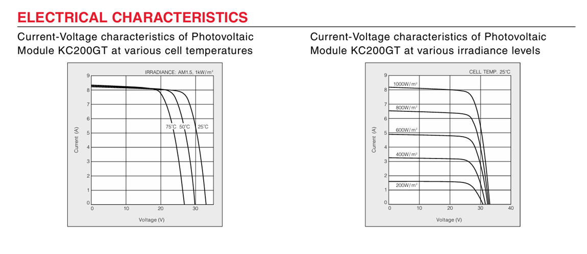
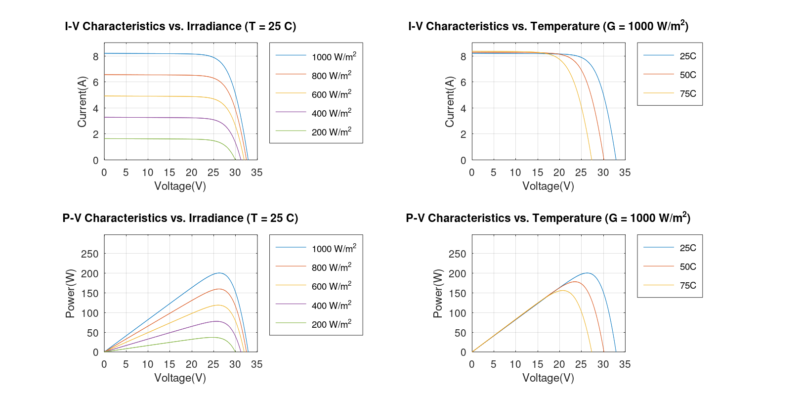
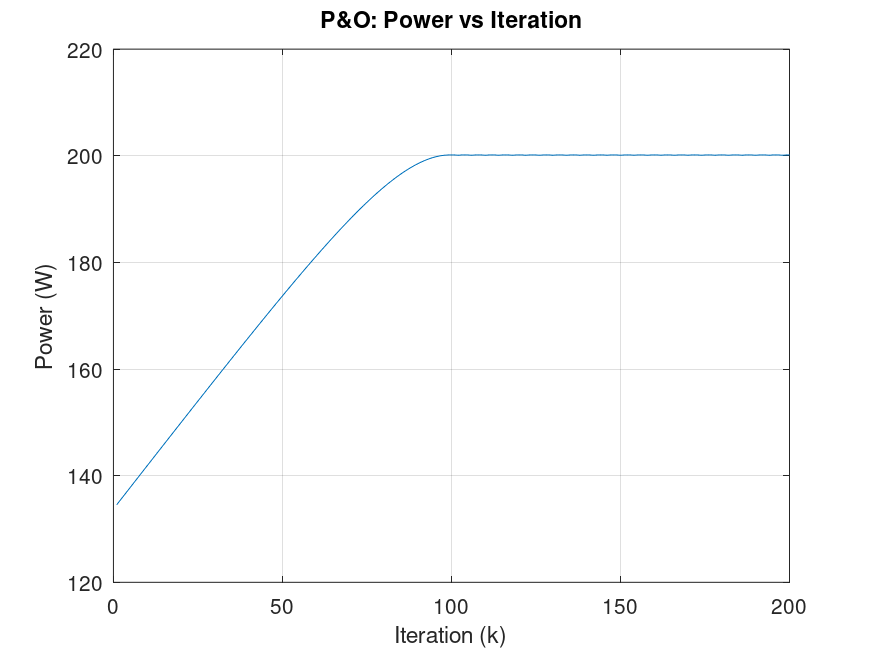
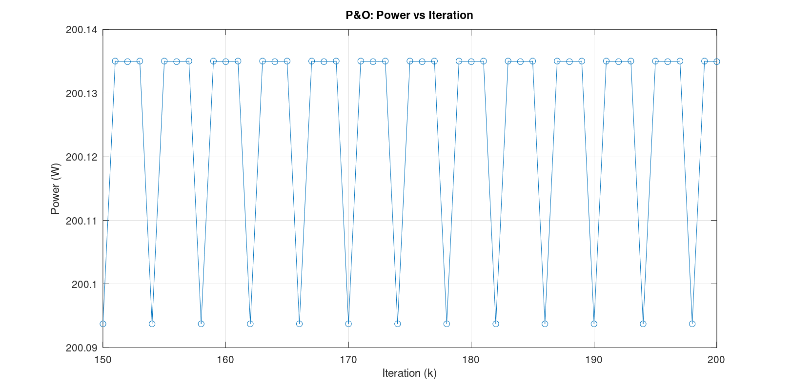

# Phase 1: PV Module Modelling and MPPT

## 1. Objective
Mathematical Modelling of a Photovoltaic Module and Perturb & Observe MPPT implementation using a real panel datasheet (Kyocera KC200GT). The objectives are:
1. Development of a physical model of a PV module based on datasheet parameters.
2. Analysis of its I-V and P-V characteristics under varying irradiance and temperature.
3. Implementation of a Perturb & Observe (P&O) MPPT algorithm to track the maximum power point (MPP) without prior knowledge of the P-V curve.

## 2. Parameter Inputs (STC: G = 1000 W/m², T = 25 °C)
| Parameter | Symbol | Value |
|---|---|---|
| Maximum power | $P_{max}$ | 200.143 W |
| Voltage at MPP | $V_{mp}$ | 26.3 V |
| Current at MPP | $I_{mp}$ | 7.61 A |
| Open-circuit voltage | $V_{oc}$ | 32.9 V |
| Short-circuit current | $I_{sc}$ | 8.21 A |
| Temp. coeff. of $V_{oc}$ | $K_v$ | −0.123 V/°C |
| Temp. coeff. of $I_{sc}$ | $K_i$ | 0.0032 A/°C |
| Cells in series | $N_s$ | 54 |
| Diode ideality factor (assumed) | $n$ | 1.3 |

## 3. Theory

### 3.1 Single Diode Model
A PV cell is modelled as a current source in parallel with a diode and a shunt resistance, with a series resistance in the output path.
Mathematically, it is defined by the equation:

$$
I = I_{ph} - I_0\left[\exp\left(\frac{V + I R_s}{n V_t}\right) - 1\right] - \frac{V + I R_s}{R_{sh}}
$$

where

| Symbol | Meaning |
|---|---|
| $I_{ph}$ | Photogenerated current |
| $I_0$ | Diode reverse saturation current |
| $R_s$ | Series resistance  |
| $R_{sh}$ | Shunt resistance |
| $n$ | Diode ideality factor |
| $V_t$| Thermal voltage of the whole series string |

Since the equation contains $I$ on both sides, it cannot be rearranged, and thus, needs to be solved numerically.

### 3.2 Finding the unknown parameters
$I_{ph}$, $I_0$, $R_s$ and $R_{sh}$ are not on the datasheet, but are required to calculate Voltage and Current. Four known operating points give four equations for the four unknowns, solved numerically with `fsolve`.

| # | Condition | Equation |
|---|---|---|
| 1 | Short circuit ($V=0,\ I=I_{sc}$) | $I_{sc} = I_{ph} - I_0\left[e^{\frac{I_{sc}R_s}{nV_t}}-1\right] - \dfrac{I_{sc}R_s}{R_{sh}}$ |
| 2 | Open circuit ($V=V_{oc},\ I=0$) | $0 = I_{ph} - I_0\left[e^{\frac{V_{oc}}{nV_t}}-1\right] - \dfrac{V_{oc}}{R_{sh}}$ |
| 3 | MPP ($V=V_{mp},\ I=I_{mp}$) | $I_{mp} = I_{ph} - I_0\left[e^{\frac{V_{mp}+I_{mp}R_s}{nV_t}}-1\right] - \dfrac{V_{mp}+I_{mp}R_s}{R_{sh}}$ |
| 4 | Power is maximal at MPP: $\left.\dfrac{dP}{dV}\right\vert_{MPP}=0$ | Given Below |

At a maximum, $\dfrac{dP}{dV} = I + V\dfrac{dI}{dV} = 0$, so the I-V curve must have slope

$$
\left.\frac{dI}{dV}\right\vert_{MPP} = -\frac{I_{mp}}{V_{mp}}
$$

at the MPP. Differentiating the diode equation gives the model's own slope, and equating the two gives an additional condition on the slope at the MPP:

$$
\frac{-\left(G_1 + \frac{1}{R_{sh}}\right)}{1 + R_s\left(G_1 + \frac{1}{R_{sh}}\right)} + \frac{I_{mp}}{V_{mp}} = 0,
\qquad
G_1 = \frac{I_0}{nV_t}\exp\left(\frac{V_{mp}+I_{mp}R_s}{nV_t}\right)
$$

**Solved parameters (STC):**

| $I_{ph}$ | $I_0$ | $R_s$ | $R_{sh}$ |
|---|---|---|---|
| 8.2132 A | 9.7629 × 10⁻⁸ A | 0.2308 Ω | 595.96 Ω |

### 3.3 Generating the I-V curve

For a **fixed** voltage the diode equation has one unknown ($I$), which, the `fzero` can solve. Varying $V$ from $0$ to $V_{oc}$ and solving at each point traces the full curve. Power curve is similarly calculated as $P = V \cdot I$.

### 3.4 Irradiance and temperature correction
But since we are plotting against different values of irradiance and temperature (other than STC), we need to use the following for correction:

$$
I_{ph}(G,T) = I_{ph,STC}\,\frac{G}{G_{STC}} + K_i\,(T - T_{STC})
$$

$$
I_0(T) = I_{0,STC}\left(\frac{T}{T_{STC}}\right)^3 \exp\left[\frac{q E_g}{n k}\left(\frac{1}{T_{STC}} - \frac{1}{T}\right)\right]
$$

with $E_g = 1.12$ eV for silicon. $R_s$ and $R_{sh}$ are held constant.

### 3.5 Perturb & Observe MPPT

A real controller only measures the present $V$ and $I$. It cannot see the whole curve, so it moves along the curve untill it finds the maximum point.
It uses the logic 
```
measure P(k)
if P(k) >= P(k-1):  keep the same voltage direction
else:               reverse direction
V(k+1) = V(k) + direction * step
```

which results in repeated oscillation by the controller about the peak, depending on the step size. This means
* A larger step size will reach the peak faster, but lead to wider oscillations and more energy loss
* A smaller step size will reach the peak slowly, but once reached will have smaller oscillations and less energy loss
Step size is therefore a trade-off between tracking speed and steady-state power loss

## 4. Results

### 4.1 Datasheet vs Model
**Datasheet Curves**


**Model Curves**

*I-V and P-V curves at varying irradiance (T = 25 °C) and varying temperature (G = 1000 W/m²). The curves reproduced by the model are similar to those shown in the data sheet.*

Comparing the output from the model to the datasheet values:
- $I$ at $V=0$ is about 8.21 A, matching $I_{sc}$.
- The knee sits near 26 V, matching $V_{mp}$.
- $I = 0$ at 32.9 V, matching $V_{oc}$.
- The P-V peak is about 200 W, matching $P_{max} = 200.143$ W.

### 4.2 P&O behaviour



*Power vs iteration for the P&O tracker, starting at $0.5\,V_{oc}$. Reaches the maximum power point at around 100 iterations.*

  

*Zoom on the last iterations: a repeating cycle around $P_{max}$. Shows how the controller keeps oscillating around the peak point after reaching the steady state peak power.*

| Step size | Result |
|---|---|
| 1 V | Reaches the peak in about 20 iterations, visibly wide oscillation |
| 0.1 V | Converges at around 100 iterations, oscillation band of about 0.04 W around $P_{max}$ (used in the model) |
| 0.01 V | Too slow, about 985 iterations are needed |

## 5. Files

| File | Purpose |
|---|---|
| `pv_module_main.m` | Solves the four parameters, builds I-V/P-V curves, G and T sweeps |
| `pv_model_po.m` | P&O MPPT simulation on the fitted panel model |
| `images/` | Saved figures used in this README |

Key functions: `func1` (4-equation system for `fsolve`), `func2` (single-diode I-V equation for `fzero`), `correct_param` (Irradiance/Temperature correction).

## 6. How to run

Requires **GNU Octave** (no extra packages; `fsolve` and `fzero` are built in).

```octave
pv_module_main   % parameter extraction and curves
pv_model_po     % P&O tracking simulation
```

[⬅ Back to main README](../README.md)