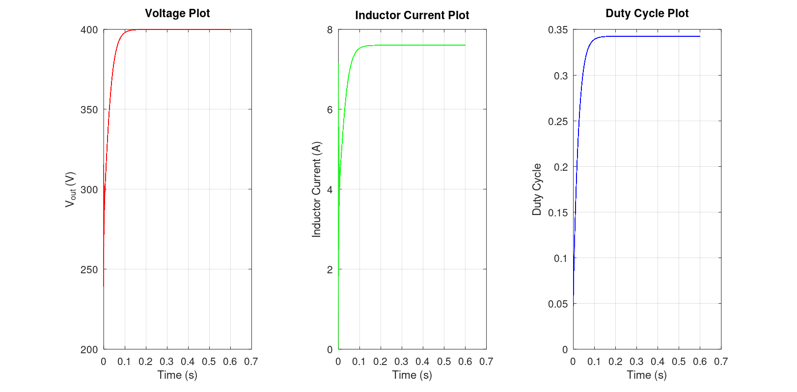

# Phase 2: Boost Converter with PI Control 
## 1. Objective
This is an Octave based simulation of a DC-DC boost converter, with its output voltage regulated by a PI controller. The converter steps up the voltage from a string of 10 PV modules (~263V) up to 400V DC link (which can be later converted to 230V RMS AC).

## 2. Theory

### 2.1. Switching states

| State | Duration | Inductor | Capacitor |
|---|---|---|---|
| Switch ON | $DT_s$ | $L\frac{di_L}{dt} = V_{in}$ | $C\frac{dV_{out}}{dt} = -\frac{V_{out}}{R}$ |
| Switch OFF | $(1-D)T_s$ | $L\frac{di_L}{dt} = V_{in} - V_{out}$ | $C\frac{dV_{out}}{dt} = i_L - \frac{V_{out}}{R}$ |

### 2.2. Model Equations    

Averaging the ON and OFF states with weights $D$ and $1-D$ gives:

**Inductor equation:**

$$
L\frac{di_L}{dt} = V_{in} - (1-D)V_{out}
$$

**Capacitor equation:**

$$
C\frac{dV_{out}}{dt} = (1-D)i_L - \frac{V_{out}}{R}
$$

**Under Steady State**

The output Voltage is given by:

$$
{\frac{V_{out}}{V_{in}}=\frac{1}{1-D}}
$$

The average inductor current is given by:

$$
{i_L=\frac{V_{out}}{(1-D)R}}
$$

**Control Law**

The error is defined as:

$$
e = V_{ref} - V_{out}
$$

The duty cycle is:

$$
D = K_p \cdot e + K_i \int e\cdot dt, \qquad 0 \leq D \leq 0.9
$$

## 3. Design

Specification: $V_{in} = 263$ V (maximum power point voltage of 10 modules in series, $10 \times 26.3$ V), $V_{out} = 400$ V, $P_{out} = 2$ kW, $f_s = 50$ kHz, inductor ripple 20 %, output ripple 1 %.

| Quantity | Formula | Value |
|:---|:---|---:|
| Duty cycle | $D = 1 - \frac{V_{in}}{V_{out}}$ | 0.3425 |
| Inductor current | $I_L = \frac{P_{out}}{V_{in}}$ | 7.6 A |
| Inductance | $L = \frac{V_{in} D T_s}{\Delta i_L}$ | 1.18 mH |
| Output current | $I_{out} = \frac{P_{out}}{V_{out}}$ | 5 A |
| Capacitance | $C = \frac{I_{out} D T_s}{\Delta V_{out}}$ | 8.56 µF |
| Load resistance | $R = \frac{V_{out}^2}{P_{out}}$ | 80 Ω |
| LC period | $T_0 = 2\pi\sqrt{LC}$ | 0.63 ms | 

## 4. Results

### 4.1 Steady State Results

With $K_p = 0.0005$ and $K_i = 0.1$, the controller drives the output to the design point:

| Quantity | Simulated Value | Design Value |
|:---|---:|---:|
| Output voltage, $V_{out}$ | 400.00 V | 400 V |
| Duty cycle, $D$ | 0.3425 | 0.3425 |
| Inductor current, $i_L$ | 7.60 A | 7.6 A |

### 4.2 Stability Analysis

At $K_i = 0.1$:

| Proportional Gain, $K_p$ | Observed Response |
|:---:|:---|
| 0.002 | Sustained oscillations with approximately 130 V ripple |
| 0.001 | Sustained oscillations with approximately 130 V ripple |
| **0.0005** | **Stable.** Voltage decreases from 0.1789 V (early) to below 0.0001 V (steady state) |

The graphs plotted (at $K_i = 0.1$ and $K_p = 0.0005$) are:

## 5. Observations

* The controller settles at the duty cycle predicted by $D = 1 - V_{in}/V_{out}$, and $V_{out}$ and $i_L$ match their design values.
* At $K_i = 0.1$, $K_p = 0.0005$ is stable, while $K_p = 0.001$ and $0.002$ produce sustained oscillation of about 130 V.

## 6. Limitations
* Averaged model: no switching ripple.
* Considers lossless components: no inductor resistance, diode drop or switching loss.
* Considers constant 263 V ideal input source.
* Gains are tuned for this operating point only.

## 7. Files

| File | Description |
|:---|:---|
| `boost_pid.m` | PI-controlled boost converter with early- and late-stage ripple stability checks |

[← Back to main README](../README.md)

